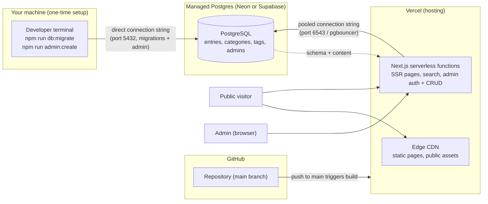

# Hephaestus' Automaton

A public, curated directory and knowledge library for AI models, apps,
development tools, hardware, research, and learning resources. The site
stores **directory metadata only** — names, descriptions, categories,
tags, and links to canonical sources. It does not mirror or host the
linked content; external resources remain the property of their owners.

The public experience is read-only. The owner manages entries through a
protected single-admin interface.

- **Stack:** Next.js (App Router, TypeScript) · Tailwind CSS v4 ·
  PostgreSQL · Drizzle ORM · Zod · jose JWT sessions + bcryptjs
- **Hosting:** Vercel (Next.js app) + managed PostgreSQL (Neon or
  Supabase)

---

## 1. Prerequisites

- Node.js 20+ and npm
- Docker (for the local PostgreSQL container)
- A PostgreSQL 15+ provider for production (Neon or Supabase recommended)

## 2. Local setup

```bash
# 1. Install dependencies
npm install

# 2. Create your local environment file from the example
copy .env.example .env   # Windows   (cp .env.example .env on macOS/Linux)

# 3. Generate a session secret and put it in .env (must be >= 32 chars)
openssl rand -base64 32

# 4. Start the local PostgreSQL container (host port 5433)
npm run db:start

# 5. Apply migrations, then optionally seed demo data
npm run db:migrate
npm run db:seed
```

`.env.example` contains placeholder values only. `.env` is gitignored;
never commit real credentials.

`npm run db:seed` inserts clearly identified demo categories and entries
(no admin credentials) and is idempotent on slugs — safe to re-run.

## 3. Commands

| Command | Purpose |
|---|---|
| `npm run dev` | Development server (<http://localhost:3000>) |
| `npm run build` | Production build |
| `npm run start` | Serve the production build locally |
| `npm run lint` | ESLint |
| `npm run typecheck` | TypeScript strict check, no emit |
| `npm run db:start` / `db:stop` | Start/stop the local Postgres container |
| `npm run db:generate` | Generate Drizzle migrations from the schema |
| `npm run db:migrate` | Apply pending migrations |
| `npm run db:studio` | Drizzle Studio (schema/data browser) |
| `npm run db:seed` | Seed demo categories/entries (idempotent) |
| `npm run admin:create` | Create the admin account (interactive CLI) |
| `npm run verify:auth` | Playwright E2E auth regression suite (8 checks) |
| `npm run verify:crud` | Playwright E2E admin CRUD suite (36 checks) |

Both verify scripts expect a running server on **port 3100**:

```bash
npm run build
$env:PORT=3100; npm run start      # PowerShell
# in another shell:
npm run verify:auth
npm run verify:crud
```

Note: the login endpoint is rate-limited (5 attempts / 10 min per IP),
and each suite run signs in. Running the suites repeatedly against the
same server can trip the limiter — restart the production server (or
wait 10 minutes) before re-running.

## 4. Database schema and migrations

Schema is defined in `src/db/schema.ts` and managed by drizzle-kit:

- `users` — admin accounts (bcrypt password hashes only, never plaintext)
- `categories` — editable top-level taxonomy (unique slugs)
- `tags` — editable freeform tags (unique slugs)
- `entries` — directory/learning entries: `name`, unique `slug`,
  `summary`, `description`, validated `canonicalUrl`, `entryType`,
  `status` (`draft` / `published` / `archived`), `featured`, timestamps,
  plus optional metadata (`creator`, `license`, `pricing`, `modality`,
  `skillLevel`, `lastVerifiedAt`, …)
- `entry_tags` — many-to-many join with FK integrity

After changing `src/db/schema.ts`:

```bash
npm run db:generate   # review the generated SQL in drizzle/
npm run db:migrate    # apply locally, then in production
```

Review every generated migration before applying. Migrations must never
unintentionally destroy data; destructive changes require an explicit,
reviewed migration.

## 5. Creating the first admin (secure, no defaults)

Admin accounts are **never** seeded. Provision the admin with
`scripts/create-admin.ts` against the target database. It accepts flags
or `ADMIN_EMAIL` / `ADMIN_PASSWORD` env vars; plaintext is never stored
or logged (bcrypt cost 12):

```bash
# against the local database
npm run admin:create -- --email admin@example.com --password 'long-secret'

# against the production database (run locally with the prod URL)
$env:DATABASE_URL="postgres://...neon/..."; npm run admin:create -- --email admin@example.com --password 'long-secret'
```

Password must be at least 12 characters (a long random value such as
`openssl rand -base64 24` is recommended). Re-running with the same email
resets that account's password. There is no default admin, no default
password, and no sign-up path.

## 6. Deploying to Vercel

### Deployment architecture



Connections and secrets:

- **Runtime (`DATABASE_URL`)** — the app uses the **pooled** connection
  string; Vercel serverless functions open many short-lived connections
  and the pooler keeps you under Postgres connection limits.
- **Admin tasks (`db:migrate`, `db:seed`, `admin:create`)** — run
  locally against the **direct** connection string; DDL and script
  access don't need the pooler.
- `AUTH_SECRET` and `DATABASE_URL` live only in Vercel env vars (and
  your local `.env.local`, which is git-ignored). They are never
  committed or exposed to the client bundle.

1. **Create the managed database.** In Neon (or Supabase), create a
   project and copy the **pooled** connection string
   (`postgres://...-pooler.../neondb?sslmode=require`). Keep it secret.
2. **Apply migrations and create the admin** from your machine using
   that URL (`npm run db:migrate`, then `npm run admin:create` as above).
3. **Connect the repo to Vercel:** import the Git repository at
   <https://vercel.com/new>; the Next.js preset needs no build overrides.
4. **Set environment variables** (Project → Settings → Environment
   Variables) for Production (and Preview as needed):

   | Variable | Value |
   |---|---|
   | `DATABASE_URL` | The pooled Postgres connection string |
   | `AUTH_SECRET` | `openssl rand -base64 32` (fresh value for production) |
   | `NEXT_PUBLIC_SITE_URL` | The production URL, e.g. `https://hephaestus.example.com` |

5. **Deploy.** Vercel builds from Git; every push to `main` redeploys.
6. Verify the deployment: the public pages render, `/admin` redirects to
   the login page when signed out, and admin sign-in works.

Preview deployments share the project env vars by default — point them
at a separate database if you do not want previews touching production
data.

## 7. Backup and restore

**Export (logical backup) with `pg_dump`:**

```bash
# Production (Neon example; add sslmode=require)
pg_dump "$DATABASE_URL" --format=custom --file=hephaestus-$(date +%F).dump

# Local container
docker exec hephaestus-db pg_dump -U hephaestus -d hephaestus --format=custom --file=hephaestus.dump
# copy out: docker cp hephaestus-db:/hephaestus.dump .
```

**Restore with `pg_restore`:**

```bash
pg_restore --clean --if-exists --dbname "$DATABASE_URL" hephaestus-YYYY-MM-DD.dump
```

Notes:

- Store dumps in a private, encrypted location; they contain all site
  content and user password **hashes** (bcrypt, not plaintext).
- Neon/Supabase manage infrastructure backups, but take your own
  periodic logical exports before migrations or admin deletions.
- `pg_restore --clean` drops and recreates objects — double-check the
  target database before running it.
- A pre-migration dump is the safety net for any schema migration.

## 8. Security model (summary)

- Public queries return **published entries only**; drafts and archived
  entries never reach public pages, metadata, or the sitemap.
- Every admin page and mutation is authorized server-side
  (`requireAdmin`); an edge proxy guards `/admin*` routes. Hiding UI is
  never the authorization mechanism.
- All inputs are validated server-side with shared Zod schemas; URLs are
  restricted to HTTP(S) (`javascript:`, `data:`, … are rejected).
- Sessions are HS256 JWTs in HttpOnly, SameSite=Lax cookies (`Secure` in
  production). Login is rate-limited (5 attempts / 10 min per IP).
- Parameterized Drizzle queries only; no string-concatenated SQL.
- Secrets live in environment variables; only `.env.example` is
  committed.

## 9. Definition of done

`PHASES.md` tracks the phased build plan against the authoritative
specification in `AGENTS.md`, including a verification log of every
lint/typecheck/build/E2E run per phase.
